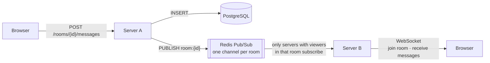
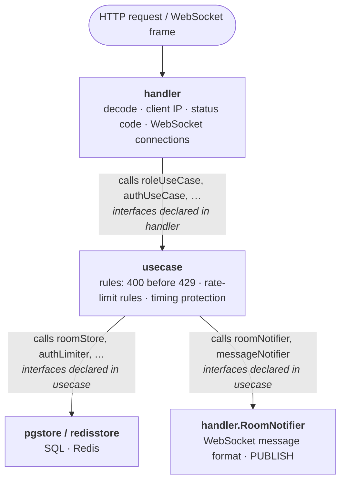
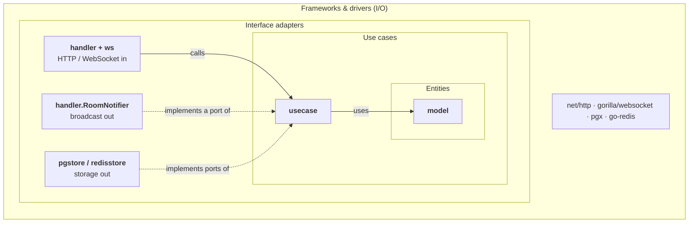

# Danmaku

English · [繁體中文](README.zh-TW.md)

Real-time *danmaku* (bullet comments) for live rooms: messages typed by viewers fly across everyone's
screen in real time. A Go backend built to scale horizontally, plus a React client.

**Live demo**: paused, since the backend host's free trial has ended. To try it, run it locally ([Getting started](#getting-started)).

I built this to learn backend engineering after years of mobile development (Kotlin / Flutter). The focus
is on the parts tutorials skip: what breaks when there is more than one server, when Redis stalls, when a
client is slow, or when old and new code run at the same time. The non-trivial decisions are written up in
[`docs/design/`](docs/design/README.md).

## Features

- **Rooms** with owners, addressed by an unguessable public id; soft delete; per-user room quota
- **Real-time broadcast** over WebSocket across multiple servers (Redis Pub/Sub, one channel per room)
- **Accounts**: register / login, JWT access tokens, rotating refresh tokens with theft detection
- Anonymous viewers can watch; logging in over the open WebSocket upgrades the connection
- **Recovery**: clients catch up on the latest messages after reconnecting; a server that stops receiving from Redis detects it and recovers by itself
- **Viewer count** per room across servers: several tabs count as one person; viewers on a dead server
  expire on their own. The home page lists the most-watched rooms first
- **Abuse protection**: rate limits per user, per IP and per username (login); timing-safe login against
  account enumeration; Unicode-aware input validation
- **Operability**: structured JSON logs with request IDs (also across WebSocket), Prometheus metrics,
  panic recovery, graceful shutdown, migrations applied on startup

## Design highlights

| Problem | Decision | Write-up |
|---|---|---|
| With one global channel, every server received every room's traffic, so adding servers didn't help | One Redis channel per room; each server subscribes only to rooms its own viewers are in, with a 30 s debounce against 0↔1 flapping; `join_ok` waits for Redis to confirm the subscription so no message falls in the gap | [0001](docs/design/0001-per-room-pubsub.md) |
| When Redis stalled, every join/leave on the server froze for 5–15 s, and one timeout could reset the connection for all rooms | Reconciliation loop: events only mark rooms dirty in memory; one worker compares desired vs actual state and talks to Redis outside the lock | [0002](docs/design/0002-reconciliation-loop.md) |
| One slow phone could stall broadcasts to every room for 10 s | Per-connection outbox and writer goroutine; a full outbox disconnects that client, which then reconnects and catches up | [0003](docs/design/0003-slow-client-outbox.md) |
| "Revoke all sessions" after token theft could be bypassed on purpose | Per-user `valid_after` timestamp instead of listing token states; locks, TOCTOU and `clock_timestamp()` handled explicitly | [0004](docs/design/0004-refresh-token-revocation.md) |
| Adding a `NOT NULL` column would break the old version still running during deploy | Expand / contract across two deploys | [0005](docs/design/0005-expand-contract-migration.md) |
| Zero-width, bidi-override and Zalgo text in messages and room names | PRECIS (RFC 8264) to reject invalid text without rewriting it; layout isolation on the client | [0006](docs/design/0006-input-validation.md) |
| Anyone could make Prometheus run out of memory by requesting random URLs | Metric labels are restricted to known values (route pattern, standard methods), with a test that runs requests through the real middleware chain | [0007](docs/design/0007-metrics-cardinality.md) |
| Offset pagination repeats or skips rooms when the list changes, and gets slower the deeper you page | Keyset pagination on `(created_at, public_id)` with a partial index; fetch `limit+1` to detect the next page; an opaque page token that the server parses strictly (unknown fields, trailing data, version, id format → 400) | [0008](docs/design/0008-cursor-pagination.md) |
| One 13-method store interface: every handler depended on methods it never called, test fakes compiled while missing methods, and handlers imported the Postgres package just for its errors | Each handler declares a small interface with only the methods it calls (Go interfaces are satisfied implicitly); domain errors live in a dependency-free `model`; Postgres and Redis code in separate packages, so only `main.go` knows the backends | [0009](docs/design/0009-consumer-side-interfaces.md) |
| A viewer count across servers has to dedupe people with several tabs and survive a server dying without cleaning up | One Redis sorted set per room with a member per connection; entries expire unless renewed, using Redis time; a single worker per server reconciles the Hub against what it last wrote, so an old snapshot can't overwrite a new one; failed writes favor a brief undercount over a 30 s ghost | [0010](docs/design/0010-room-presence.md) |
| A Pub/Sub connection can go half-open and silently stop delivering to every room on a server, while pings and HTTP keep working | Each server publishes a heartbeat to itself and expects it back on that connection; two misses rebuild the connection and tell clients to fetch again. Measured with a proxy that stops forwarding without closing: recovered in 35–44 s | [0011](docs/design/0011-message-delivery-recovery.md) |
| Room owners couldn't stop a troll, and the old plan's site-wide, in-memory ban didn't fit per-room roles | Room-level shadow bans filtered at read time, so a mistaken ban is fully reversible; one `room_roles` row per person; hierarchy rules in one fail-closed pure function; checks ordered so a viewer can't probe users; no API response tells a banned user. Verified across two servers with real Redis and in a browser | [0012](docs/design/0012-room-moderation.md) |
| Business rules were spread across handlers and the store; the HTTP and WebSocket paths each called the store directly for "room exists" / "who is this user", and a timing-protection test had to go through HTTP | One use case per domain with no HTTP, SQL or WebSocket format; handlers keep transport work (client IP, connection state, read-loop timeouts). Behavior preserved by unchanged handler assertions, characterization tests run on the old code first, and mutation testing | [0013](docs/design/0013-use-case-layer.md) |
| Chat systems often make writes asynchronous, at the cost of messages that are broadcast but never stored | Measured first: at 100 msg/s `POST` p99 was about 6 ms, writes stayed under 3 ms and did not slow down up to 2,500 viewers × 100 msg/s, and the CPU went to fan-out. Kept synchronous writes. At 5,000 × 100 the test Mac stalled first (the evidence points to kernel network memory running out), and one server crashed from stuck writes using up its threads | [0014](docs/design/0014-load-baseline-keep-sync-writes.md) |
| Sorting rooms by viewers needs the counts stored somewhere, and a room nobody watches any more must drop off without anyone noticing it went quiet | One Redis sorted set of counts, written after each count; a room stays on it only while its presence key exists, which disappears on its own both when the last viewer leaves and when the server holding the last viewers dies, so readers clean up lazily. Top N only: a cursor over numbers that keep changing would skip or repeat rooms | [0015](docs/design/0015-popular-rooms-ranking.md) |

## Architecture



- A load balancer sits in front: Nginx (`least_conn`) locally, Railway in production. The servers keep no
  state that can't be rebuilt (tokens are checked with a shared secret, refresh tokens live in PostgreSQL,
  rate-limit counters and fan-out in Redis), so **no sticky sessions** are needed.
- Messages are written through HTTP; the WebSocket is used only for receiving, joining rooms and auth.
- Verified with two local servers behind Nginx and with 2 replicas on Railway.

Each server subscribes only to rooms that have viewers on it: `SUBSCRIBE` when the first viewer joins, and
`UNSUBSCRIBE` only **30 seconds** after the last one leaves (if someone comes back in that window, no new
subscribe is needed, so a quiet room flickering between 0 and 1 viewers doesn't keep sending commands). So
when debugging with `redis-cli PUBSUB CHANNELS 'room:*'`, a channel stays for about 30 seconds after its
room empties; that is not a subscription leak.

### Inside the server

How a request flows (arrows are **calls**):



The same packages mapped onto Clean Architecture's rings. Here arrows mean **"knows about"**: which
side has to know the other's contract. They all point inward. That is why the storage, below the use
cases in the first diagram, sits *outside* them here: the use case defines what it needs, and storage
plugs into it. In Go only `usecase → model` is an actual import; the other arrows are satisfied through
interfaces (last bullet below).



- **Entities: `model`.** Data types, domain errors (`ErrRoomNotFound`, …) and small rules
  (`ValidPublicID`). Imports only the standard library.
- **Use cases: `usecase`.** Business rules, one struct per domain (rooms, roles, messages, auth), with
  no HTTP, SQL or WebSocket format. Each use case declares its **ports**, the interfaces for what it
  needs from outside (`roomStore`, `authLimiter`, `roomNotifier`, …). It also uses pure helper packages
  with no I/O: `auth` (bcrypt, JWT), `textrule`, `ratelimit`. See [ADR 0013](docs/design/0013-use-case-layer.md).
- **Interface adapters.** *In*: `handler` (with its HTTP helpers `httpx` and `middleware`) turns HTTP / WebSocket into use case calls and results into
  responses; it also owns WebSocket connection state (the Hub in `ws`, per-room subscriptions), which is
  transport work, not business rules. *Out*: `pgstore`, `redisstore` and `handler.RoomNotifier` implement
  the use cases' ports. Transport-side needs of the handler itself (`wsPubSub`, `healthChecker`, …) are
  small interfaces that the stores satisfy directly.
- **Frameworks & drivers.** Only the adapters touch the I/O libraries (net/http, gorilla/websocket,
  pgx, go-redis). Metrics are the exception: `internal/prometheus` is a process-global facade that any
  layer may call.
- **`cmd/server`** (`main.go`) sits outside the rings: the composition root, the only code that sees
  every concrete type and the only place that knows the backends are Postgres and Redis.
- In most languages an adapter has to import the use case to implement its port. Go interfaces are
  satisfied implicitly, so neither `handler` nor the stores import `usecase` (outside tests). See
  [ADR 0009](docs/design/0009-consumer-side-interfaces.md).
- Other packages: `config`, `logging`, `randx`.

## How it was built

- Every change goes through design → implementation → independent review. Fixes are checked with
  **mutation testing**: deliberately break the code and confirm some test fails.
- Integration tests run against real PostgreSQL and Redis, with `-race`.
- Failure modes were reproduced locally before being fixed: pausing Redis (`CLIENT PAUSE`), dropping
  packets through a proxy, killing the Pub/Sub connection, and clients that never read.

## Tech stack

- **Backend**: Go (`net/http`, gorilla/websocket, pgx, go-redis), golang-migrate, JWT (HS256), bcrypt
- **Frontend**: React + TypeScript + Vite
- **Data**: PostgreSQL 17, Redis 7 (Pub/Sub, rate limiting)
- **Infra**: Docker Compose, Nginx; Railway (backend) + GitHub Pages (frontend)
- **Observability**: slog JSON logs; Prometheus + Grafana, Promtail + Loki (local)

## Status

Started 2026-10-08. Done so far: real-time messaging across multiple servers, auth with refresh-token
rotation, rooms with a paginated room list, cross-server viewer counts with a popular-rooms ranking, recovery from missed messages, room
roles and shadow bans, rate limiting, observability, a load-test baseline (writes stay synchronous), and the
hardening described above. Next: a minimal CI, then scripted fault scenarios. See the
[milestones in ROADMAP.md](ROADMAP.md#milestones2026-11-03-訂暫定) (in Chinese).

## Getting started

Prerequisites: Go 1.27+, Node.js 18+, Docker.

### Multi-instance (Docker Compose)

```bash
docker compose up --build
```

This starts PostgreSQL, Redis, two Go servers, Nginx, Loki + Promtail + Grafana and Prometheus.

| Service | URL |
|---|---|
| Nginx (entry point) | `http://localhost:5390` |
| Server-1 / Server-2 (direct) | `http://localhost:5388` / `http://localhost:5389` |
| Grafana | `http://localhost:5392` (admin / admin) |
| Prometheus | `http://localhost:5393` |

```bash
cd client
VITE_WS_URL=ws://localhost:5390/ws VITE_API_URL=http://localhost:5390 npm run dev
```

### Single server

```bash
docker run -d --name danmaku-db -p 3192:5432 -e POSTGRES_USER=danmaku -e POSTGRES_PASSWORD=danmaku -e POSTGRES_DB=danmaku -v danmaku_pgdata:/var/lib/postgresql/data postgres:17
docker run -d --name danmaku-redis -p 2907:6379 --tmpfs /data redis:7 --save ""

cd server && JWT_SECRET="$(openssl rand -base64 48)" go run ./cmd/server   # migrations run on startup
cd client && npm install && npm run dev                                    # http://localhost:5173/danmaku/
```

`JWT_SECRET` is required (at least 32 bytes). See [Environment Variables](README.zh-TW.md#environment-variables).

### Git hooks

Run once per clone. Pre-commit checks `gofmt`, `go vet` and the client lint; pre-push runs all tests and the
client build, for whichever of `server/` and `client/` changed. Tests use a separate database, so create it too:

```bash
git config core.hooksPath .githooks
docker exec danmaku-db createdb -U danmaku danmaku_test
```

### Load test tool

`server/cmd/loadtest` checks locally whether writes are the first bottleneck. The baseline (writes are not; see
[ADR 0014](docs/design/0014-load-baseline-keep-sync-writes.md)) is from one Mac and is for comparisons, not capacity.
On this Mac 250 k frames/s was fine; at 500 k every connection on the machine stalled. It only accepts localhost, the `danmaku_test` database and Redis db 15,
sends at a fixed rate with latency timed from the scheduled send, and marks a step invalid when the machine is busy.
Usage is in the [Chinese README](README.zh-TW.md).

## API overview

| Method | Path | Auth | |
|---|---|---|---|
| `POST` | `/register`, `/login` | | `/login` returns an access token + a refresh token |
| `POST` | `/refresh`, `/logout` | | rotate / revoke a refresh token |
| `GET` | `/me` | ✓ | current user |
| `POST` | `/rooms` | ✓ | create a room |
| `GET` | `/rooms/{public_id}` | | room info |
| `GET` | `/rooms` | | list rooms, newest first (cursor pagination: `limit`, `page_token`); `?sort=viewers` returns the most-watched rooms with `viewer_count`, no pagination (`page_token` → `400`), `503` if the ranking can't be read |
| `GET` | `/me/rooms` | ✓ | list my rooms (same pagination) |
| `GET` | `/rooms/{public_id}/me` | ✓ | my role in this room |
| `GET` | `/rooms/{public_id}/roles` | ✓ | moderators and bans, for the owner and moderators (same pagination) |
| `PUT`, `DELETE` | `/rooms/{public_id}/roles/{user_id}` | ✓ | make a moderator or ban (`{"role": ...}`); remove |
| `GET` | `/rooms/{public_id}/messages` | | latest messages |
| `POST` | `/rooms/{public_id}/messages` | ✓ | post a message (rate limited) |
| `GET` | `/ws` | | WebSocket: `join` / `leave` / `auth` / `ping` frames; receives `message` |
| `GET` | `/healthcheck`, `/metrics` | | health, Prometheus |

HTTP errors return `{"error": {"code": "...", "message": "..."}}` with `Cache-Control: no-store`. The exception is
the mux's built-in plain-text `404` and `405` for an unknown path or wrong method.

Full reference (status codes, WebSocket protocol and error codes, migrations, deployment, environment
variables) is in the [Chinese README](README.zh-TW.md#api).
