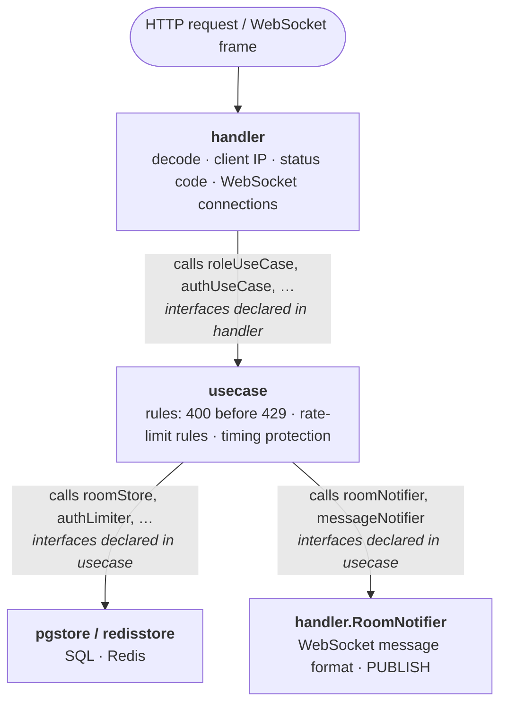
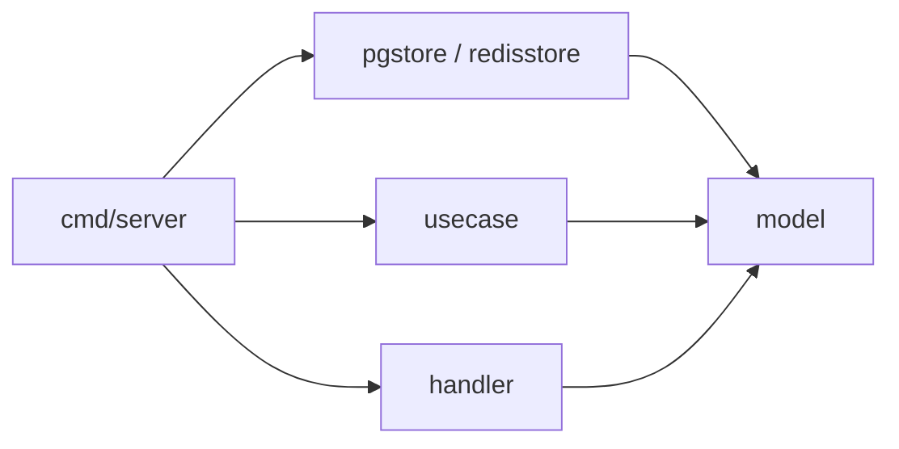

# 0013 — A use case layer between handlers and stores

**Status**: Accepted (2026-11-16, refactor only; behavior unchanged except for the logs listed below)

## Context

From M1 to M6 a handler called the store directly. The dependency direction was already right
([ADR 0009](0009-consumer-side-interfaces.md): interfaces declared by the consumer, domain errors in
`model`, only `main.go` knows the backends), but there was nowhere for business rules to live. They
ended up split between the handler and `pgstore`:

- `HandleLogin` had nine steps; only decoding the body and writing the response were about HTTP. The
  rate-limit rules, the dummy-hash timing protection, token issuing and the Reset / Refund of the
  counters sat next to `http.ResponseWriter`.
- Some rules were needed by a second entry point. "The room must exist" is checked by `GET /rooms/{id}`
  and by the WebSocket `join` frame; "user id → user" by `GET /me` and by the WebSocket `auth` frame.
- A test had to go through HTTP to check a rule that has nothing to do with HTTP: the timing-protection
  test injected a password-checker spy into the **handler**.

Reading one flow meant jumping between several files, and that cost was real.

## Decision

**1. One use case struct per domain, with no knowledge of HTTP, SQL or the WebSocket message format.**

| Use case | Methods | Depends on (consumer-side interfaces) |
|---|---|---|
| `RoleUseCase` | `ChangeRole`, `MyRole`, `ListRoles` | `roleStore`, `roomNotifier` |
| `RoomUseCase` | `CreateRoom`, `GetRoom`, `ListRooms` | `roomStore` |
| `MessageUseCase` | `Post`, `History` | `messageStore`, `messageNotifier`, `messageLimiter` |
| `AuthUseCase` | `CheckRegisterIP`, `Register`, `CheckLoginIP`, `Login`, `CheckRefreshIP`, `Refresh`, `Logout`, `CurrentUser` | `authStore`, `authLimiter`, `tokenIssuer` |

Handlers keep HTTP and WebSocket work only: decode, pick the status code, write the response. The use
case owns the rules (which room quota applies, message rate limits, login rate limits, history size),
exported where another package, including tests, needs to read them (`usecase.HistoryLimit`,
`usecase.MessageBurstRule`, …) so nobody keeps a second copy. `/healthcheck`, `/metrics` and the middleware have no business rules and stay as they are.

**2. Consumer-side interfaces on both sides, so `handler` does not import `usecase`.** Each handler
declares the use case methods it calls (`roleUseCase`, `wsRoomUseCase`, `authUseCase`, …), using only
`model` types. The two layers talk through `model`: sentinel errors for "is it this outcome"
(`ErrRoomNotFound`, `ErrInvalidCredentials`) and typed errors when the handler needs data from the error
(`*RateLimitedError` carries `RetryAfter`, read with `errors.As`). `model.TokenPair` exists for the same
reason. Use cases that need to broadcast declare a notifier interface; the implementation
(`handler.RoomNotifier`) stays next to the WebSocket message format.

How a request flows (arrows are calls):

Package imports (compile time) are a different picture: in this diagram every path ends at `model`, and outside tests
nothing but `cmd/server` imports `usecase`.

Besides `model`, `usecase` imports pure helpers (`auth`, `ratelimit`, `textrule`); `handler` imports
`httpx`, `ws`, `middleware` and `prometheus`; `pgstore` imports `randx` and the migrations, `redisstore`
imports `randx` and `prometheus`.

In Clean Architecture terms: `model` is the entities ring and `usecase` the use cases ring. The interface
adapters are `handler` (in, including the WebSocket connection state that §3 keeps there) and, going out,
`pgstore`, `redisstore` and `handler.RoomNotifier` (one type with two constructors that differ only in
the log component), which implement the use cases' output ports
(`roomStore`, `authLimiter`, `roomNotifier`, …). The I/O libraries (net/http, gorilla/websocket, pgx,
go-redis) are the frameworks and drivers. Two qualifications: `usecase` uses third-party code through
pure helpers with no I/O (bcrypt and JWT in `auth`, `x/text` in `textrule`), and metrics are a
process-global facade any layer may call. Because Go interfaces are satisfied implicitly, implementing a
port needs no import, so the dependency rule holds without the adapters importing `usecase`.

`cmd/server` is still the only place that wires concrete types together; one `RoomUseCase` and one
`AuthUseCase` are shared between the HTTP and WebSocket handlers.

**3. What stays in the handler.** Not everything that "does something" is a business rule:

- **Working out the client IP.** Which header to trust (`trustedHeaderKey`) is HTTP knowledge. The
  handler calls `httpx.ClientIP` and passes the use case a plain `ip` string, as it passes a `userID`
  taken from the auth context.
- **Connection state and its invariants.** The Hub, the per-room Redis subscriptions and the pairing of
  `JoinRoom` / `LeaveRoom` belong to the WebSocket connection's lifecycle. Moving the subscription into a
  use case would split one invariant across two layers.
- **Timeouts that protect the read loop** (`wsJoinTimeout`, `wsAuthDBTimeout`), and parsing the access
  token (the middleware does the same for HTTP).
- **Mapping errors to responses, and the logs tied to that mapping.** `writeRotateError` must check
  `RefreshTokenRevokedError` before `ErrRefreshTokenInvalid`, and it logs the security events. Keeping
  the log in the same switch keeps the order in one place.

**4. When an ordering rule conflicts with a pairing rule, split the method and let the caller order
the calls.** Login rate limiting counts per IP **before** the body is decoded (a blocked IP gets 429 even
with a malformed body, and a malformed body still counts as a failure). After a successful login the
same IP counter is refunded. Moving everything into `Login` would force decoding first and change the
API; leaving the IP check in the handler would put `Allow` and `Refund` in different layers. Instead the
use case exposes `CheckLoginIP` and `Login`, the handler calls `CheckLoginIP` → decode → `Login`, and
both halves of the counter stay in the use case. Register and refresh follow the same pattern.

## When to extract a use case

Starting with four layers would have produced empty pass-throughs, and the shape of the rules was not
known yet (the decode-first ordering above, "400 before 429" for messages, the `JoinRoom` / `LeaveRoom`
pairing). What has to be in place from day one is cheaper:

- the dependency direction (`model` innermost, consumer-side interfaces, a composition root), and
- handler tests that assert on the HTTP response, not on internals.

With those two, inserting a layer later is cheap. Extract a use case when one of these shows up:

1. **A rule gets a second entry point** (HTTP and WebSocket both need "the room exists").
2. **A test has to go through HTTP to check a rule unrelated to HTTP.** A test in the wrong layer means
   logic in the wrong layer; this is the most reliable signal.
3. **Most of a handler's branches are not about HTTP.**

The sign that it is too late is different: the refactor needs behavior changes, rewritten tests, or
nobody dares to touch it.

## How "no behavior change" was checked

- **Handler test assertions were not changed**, only how the handler is constructed. The handler tests
  now run against the real use case wrapping the same fakes, so they test both layers together.
- **Characterization tests first.** Where the behavior to preserve had no test (IP limiting before
  decode for login, register and refresh; "rotation succeeded but signing the access token failed →
  500"), a test was added and run on the **pre-refactor** code in a separate worktree, to prove it
  describes the original behavior rather than whatever the new code does.
- **Mutation testing** on each step: break the moved rule (skip the dummy hash, refund before issuing
  the token, decode before the IP check, `%v` instead of `%w`, …) and confirm a test fails.
- The two timing-protection subtests moved to the `usecase` package with identical assertions.

Intentional changes, all in logs only:

- Rate-limited login / register / refresh logs carry `client_ip` instead of `remote_addr`. The use case
  has no request; behind nginx `RemoteAddr` was always nginx's address anyway.
- Step-specific failure logs ("create refresh token failed", …) became one log per operation
  ("login failed", "refresh failed", …), with the step in the wrapped error (`fmt.Errorf("issue access
  token: %w", err)`), following the message use case.

## Alternatives considered

- **Leave the WebSocket `join` lookup on the store.** Fewer lines, but the HTTP and WebSocket paths would
  check "room exists" in two places, and a future visibility rule would have to be added twice.
- **A `WatchUseCase` that also does the Redis subscribe / unsubscribe.** Splits the `JoinRoom` /
  `LeaveRoom` pairing between layers; subscription is a delivery mechanism, not a business rule.
- **Move all of login into the use case and accept decoding first.** Changes the API (malformed body from
  a blocked IP → 400) and drops malformed requests from the IP count.
- **Inject the password checker through an exported option** so the timing tests could stay in the
  handler. Adds a public API that exists only for tests; the tests belong with the rule.
- **Dependency-inject the metrics** while moving rate limiting. Metrics stay process-global behind an
  event-named facade in `internal/prometheus`; DI was not worth it at this size.

## Consequences

- A new feature means: rules in a use case, HTTP / WebSocket in the handler, and the use case method
  added to the handler's interface. A handler that only needs one method declares a one-method interface.
- Some use case methods are pass-throughs today (`RoomUseCase.GetRoom`, `AuthUseCase.CurrentUser`). They
  are where the next rule goes (room visibility, account status) without touching the handlers.
- Adding another transport (gRPC, a CLI) needs a new handler only; computing the client IP or reading the
  user id is that handler's job.
- Nothing runs `main()` in tests. Passing `nil` for a use case when wiring compiles and passes every test,
  and panics on the first request that needs it.
- `GET /rooms/{id}` and the WebSocket `join` frame share one `RoomUseCase`; a rule added to `GetRoom`
  applies to both, which is the point but should be remembered when the rule is HTTP-specific.
